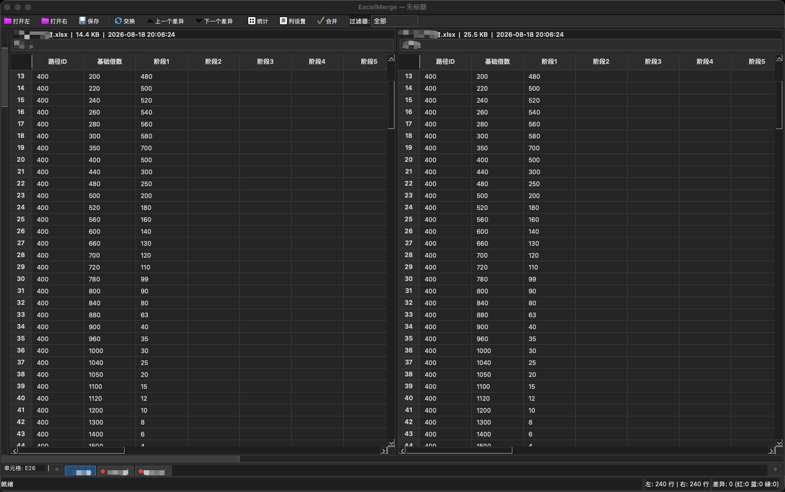

# ExcelMerge

[简体中文](./README.zh-CN.md) | **English**

[](./LICENSE)
[](https://www.python.org/)
[](https://doc.qt.io/qtforpython-6/)
[](https://openpyxl.readthedocs.io/)
[](./CHANGELOG.md)

ExcelMerge is a desktop application (macOS / Windows) for **Excel diff and merge**: load two `.xlsx` workbooks, identify row/column/cell-level differences, apply overwrite or append merges, and confirm results visually.

<p>
  
</p>

## Features

### Comparison

- Side-by-side workbooks with independent/synchronized sheet switching; sheets missing on one side are also compared.
- Smart alignment: automatic header-row detection, column alignment by name and content (order changes supported), row alignment by content or key columns (LCS + greedy).
- Difference detection: cell value diffs, row/column insertions and deletions, character-level highlight of changed fragments only.
- Navigation: bird's-eye views (row/column level), diff dots on sheet tabs, quick jump to next difference.

### Merge

- Strategies: right-over-left, left-over-right, append diff rows, whole-sheet copy, and row/column/cell-level copy/insert/delete.
- Merged-cell aware: merged ranges are rebuilt after row/column insert/delete and blocking merges are released before overwriting.
- Unsaved-change confirmation on window close or file re-open.

### UX Details

- Double-click a truncated cell to auto-fit column width/row height; double-click again to restore.
- Bottom sheet tab bar: rename, right-click close/close-others, and an all-sheets quick switcher on the nav arrows.
- Dark/light theme, toggleable row numbers, adjustable column widths.

### Licensing & Distribution

- Built-in online license activation (pairs with the standalone [excel-activation-server](./excel-activation-server/README.md)).
- macOS/Windows packaging scripts, plus a CLI launcher for Git difftool / SourceTree integration.

## Project Structure

```
ExcelMerge/
├── main.py                    # application entry
├── src/
│   ├── core/                  # GUI-independent core logic
│   │   ├── excel_loader.py    #   workbook load/save/extract
│   │   ├── comparator.py      #   row/column alignment & diff
│   │   ├── merger.py          #   merge/copy/insert/delete
│   │   └── chardiff.py        #   character-level diff
│   ├── gui/                   # PySide6 UI
│   │   ├── main_window.py     #   main window (comparison & merge)
│   │   ├── bottom_bar.py      #   sheet tab bar & navigation
│   │   ├── diff_highlight_delegate.py  # char-level highlight
│   │   ├── diff_birds_eye.py  #   row bird's-eye view
│   │   ├── diff_col_birds_eye.py       # column bird's-eye view
│   │   ├── column_settings_dialog.py   # key/ignore column settings
│   │   ├── license_dialog.py  #   activation dialog
│   │   └── themes.py          #   dark/light themes
│   ├── utils/license.py       # license check
│   └── license_server/        # license server helpers
├── excel-activation-server/   # standalone activation server (Express + SQLite)
├── packaging/                 # macOS / Windows build scripts
├── scripts/                   # CLI launcher & Git difftool setup
└── tests/                     # unit tests (~90 cases)
```

## Quick Start

```bash
git clone https://github.com/RedMaple96/ExcelMerge.git
cd ExcelMerge
python3 -m venv .venv
source .venv/bin/activate      # Windows: .venv\Scripts\activate
pip install -r requirements.txt
python main.py
```

Online activation (license code) is required on first launch; see the in-app activation dialog.

## Requirements

| Item | Note |
| --- | --- |
| Python | `3.11+` |
| GUI | `PySide6>=6.5.0` |
| Excel engine | `openpyxl>=3.1.0` |
| Packaging | `pyinstaller>=6.0.0` (build only) |
| OS | macOS / Windows |

## Packaging

```bash
# macOS: dist/ExcelMerge.app (plus .dmg when create-dmg is installed)
./packaging/mac_build.sh

# Windows: dist/Excel Merge.exe
packaging\windows_build.bat
```

## CLI / Git Difftool Integration

`scripts/excelmerge-diff.sh <left> <right>` launches the app to compare two files. After installing via `scripts/install-cli.sh`, configure Git:

```ini
[difftool "excelmerge"]
    cmd = excelmerge-diff "$LOCAL" "$REMOTE"
```

## Programmatic API (Core Modules)

The core comparison/merge logic is GUI-independent and reusable:

```python
from src.core.comparator import ExcelComparator
from src.core.excel_loader import ExcelLoader
from src.core.merger import ExcelMerger

left_wb = ExcelLoader.load_workbook("left.xlsx")
right_wb = ExcelLoader.load_workbook("right.xlsx")
left_data = ExcelLoader.extract_sheet_data(left_wb.worksheets[0])
right_data = ExcelLoader.extract_sheet_data(right_wb.worksheets[0])

diff = ExcelComparator.compare_sheets(left_data, right_data)
print(diff.stats)

ExcelMerger.merge_right_to_left(diff, left_data, right_data)
ExcelLoader.save_workbook(left_wb, "merged.xlsx")
```

## Testing

```bash
python -m unittest discover -s tests
```

Covers comparator, merger, loader, char diff, sheet matching, bottom bar, highlight rendering and license checks (GUI interaction flows require a graphical environment and are not automated).

## Contributing

1. Fork the repo and create a feature branch (e.g. `feat/your-feature`)
2. Make changes and run `python -m unittest discover -s tests`
3. Open a Pull Request describing motivation, implementation and verification

## License

[MIT](./LICENSE)

## Contact

- Maintainer: [RedMaple96](https://github.com/RedMaple96)
- Project: https://github.com/RedMaple96/ExcelMerge

## Changelog

See [CHANGELOG.md](./CHANGELOG.md). Current version: `v1.0.3` (2026-08-18).
