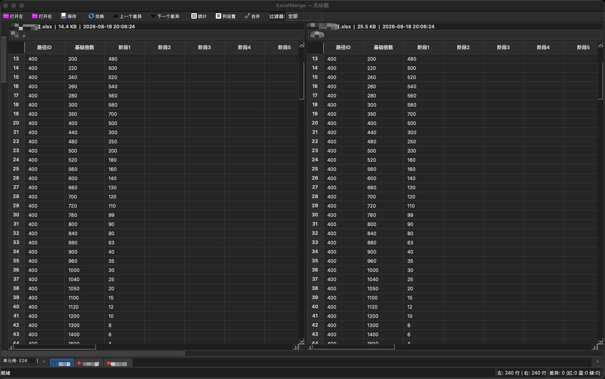

# ExcelMerge

**简体中文** | [English](./README.md)

[](./LICENSE)
[](https://www.python.org/)
[](https://doc.qt.io/qtforpython-6/)
[](https://openpyxl.readthedocs.io/)
[](./CHANGELOG.md)

ExcelMerge 是一个面向 **Excel 差异比对与合并** 场景的桌面应用（macOS / Windows），适用于加载两个 `.xlsx` 文件、识别行列与单元格级差异、执行覆盖或追加合并，并以可视化方式辅助人工确认。

<p>
  
</p>

## 功能特性

### 比对

- 双栏并排加载两个工作簿，两侧可独立切换工作表（打开文件与点击底部标签栏时才同步到同一 Sheet），Sheet 缺失（仅一侧存在）也能比较。
- 智能对齐：自动选择真实表头行、按列名与内容对齐列（支持列顺序变化）、按内容/关键字对齐行（LCS + 贪心）。
- 差异识别：单元格值差异、行增删、列增删，字符级差异高亮只标出真正变化的片段。
- 导航辅助：鸟瞰图（行/列级差异缩略图）、Sheet 标签红点提示差异、快速跳转下一个差异（精确定位到具体差异单元格）、一键定位上一个/下一个有差异的 Sheet（Ctrl+PgUp / Ctrl+PgDown）。

### 合并

- 合并策略：右覆盖左、左覆盖右、追加差异行、整表复制、整表覆盖（同名 Sheet 内容替换）、文件级整体替换、行/列/单元格级复制与增删。
- 正确处理合并单元格：插入/删除行列后自动重建合并区域，覆盖写前自动解除阻碍合并。
- 未保存确认：关闭窗口或覆盖打开文件前提示保存，避免修改静默丢失。

### 交互细节

- 双击未完全显示的单元格，自动调整列宽/行高完整展示内容；再次双击恢复。
- 底部 Sheet 标签栏支持重命名、右键关闭/关闭其他，箭头按钮右键弹出全部标签快速切换。
- 深色/浅色主题自适应，支持行号显隐、列宽调整等视图选项。

### 授权与分发

- 提供 macOS / Windows 打包脚本，并附命令行启动脚本用于配置 Git difftool / SourceTree。

## 项目结构

```
ExcelMerge/
├── main.py                    # 应用入口
├── src/
│   ├── core/                  # 核心逻辑（与 GUI 无关，可独立复用）
│   │   ├── excel_loader.py    #   工作簿加载/保存/数据提取
│   │   ├── comparator.py      #   行列对齐与差异比较
│   │   ├── merger.py          #   合并/复制/插入/删除操作
│   │   └── chardiff.py        #   字符级差异计算
│   ├── gui/                   # PySide6 界面
│   │   ├── main_window.py     #   主窗口（双栏对比、合并操作、菜单）
│   │   ├── bottom_bar.py      #   底部 Sheet 标签栏与导航
│   │   ├── diff_highlight_delegate.py  # 字符级差异高亮渲染
│   │   ├── diff_birds_eye.py  #   行级鸟瞰图
│   │   ├── diff_col_birds_eye.py       # 列级鸟瞰图
│   │   ├── column_settings_dialog.py   # 关键列/忽略列设置
│   │   ├── license_dialog.py  #   在线激活对话框
│   │   └── themes.py          #   深色/浅色主题
│   ├── utils/license.py       # 授权校验
│   └── license_server/        # 授权服务端辅助
├── excel-activation-server/   # 独立在线授权服务（Express + SQLite）
├── packaging/                 # macOS / Windows 打包脚本
├── scripts/                   # CLI 启动与 Git difftool 配置脚本
└── tests/                     # 单元测试（约 90 个用例）
```

## 快速开始

```bash
git clone https://github.com/RedMaple96/ExcelMerge.git
cd ExcelMerge
python3 -m venv .venv
source .venv/bin/activate      # Windows: .venv\Scripts\activate
pip install -r requirements.txt
python main.py
```

首次启动需在线激活（授权码），详见应用内激活对话框指引。

## 环境依赖

| 项目 | 说明 |
| --- | --- |
| Python | `3.11+` |
| GUI | `PySide6>=6.5.0` |
| Excel 引擎 | `openpyxl>=3.1.0` |
| 打包工具 | `pyinstaller>=6.0.0`（仅打包时需要） |
| 操作系统 | macOS / Windows |

## 打包分发

```bash
# macOS：生成 dist/ExcelMerge.app（装有 create-dmg 时额外生成 .dmg）
./packaging/mac_build.sh

# Windows：生成 dist/Excel Merge.exe
packaging\windows_build.bat
```

## 命令行 / Git difftool 集成

`scripts/excelmerge-diff.sh <left> <right>` 可直接调起应用比对两个文件，配合 `scripts/install-cli.sh` 安装后，可配置为 Git difftool：

```ini
[difftool "excelmerge"]
    cmd = excelmerge-diff "$LOCAL" "$REMOTE"
```

对比结果仅用于查看时用上面的配置即可。若需要在 ExcelMerge 中编辑并**保存回工作区**（而非只改临时副本），请改用 dir-diff + symlinks：

```bash
git difftool --dir-diff --symlinks --tool=excelmerge
```

此模式下 `$LOCAL`/`$REMOTE` 传的是左右两个目录，工作区文件以符号链接形式出现，ExcelMerge 会自动解析符号链接并把保存写回真实工作区文件。

### 外部合并工具（SourceTree 等 GUI）

如果通过 SourceTree 等 GUI 调起，且希望把合并结果保存回本地工作区文件，请在 SourceTree 的「外部合并工具(External Merge)」中配置为 ExcelMerge：

```
Merge Command: /Applications/ExcelMerge.app/Contents/MacOS/ExcelMerge
Arguments:    $LOCAL $REMOTE $MERGED
```

参数顺序固定为「左输入、右输入、输出到真实工作区文件」。在 ExcelMerge 中把右侧差异合并到左侧后点保存（默认保存全部），结果会写回 `$MERGED` 对应的本地文件。

## 编程接口（核心模块）

核心比较与合并逻辑独立于 GUI，可直接在 Python 中使用：

```python
from src.core.comparator import ExcelComparator
from src.core.excel_loader import ExcelLoader
from src.core.merger import ExcelMerger

left_wb = ExcelLoader.load_workbook("left.xlsx")
right_wb = ExcelLoader.load_workbook("right.xlsx")
left_data = ExcelLoader.extract_sheet_data(left_wb.worksheets[0])
right_data = ExcelLoader.extract_sheet_data(right_wb.worksheets[0])

diff = ExcelComparator.compare_sheets(left_data, right_data)
print(diff.stats)

ExcelMerger.merge_right_to_left(diff, left_data, right_data)
ExcelLoader.save_workbook(left_wb, "merged.xlsx")
```

## 测试

```bash
python -m unittest discover -s tests
```

覆盖核心模块：比较器、合并器、加载器、字符级 diff、Sheet 匹配、底部标签栏、高亮渲染与授权校验（GUI 交互流程依赖图形环境，未纳入自动化）。

## 贡献指南

1. Fork 本仓库并创建功能分支（如 `feat/your-feature`）
2. 完成改动并运行 `python -m unittest discover -s tests` 自检
3. 发起 Pull Request，说明动机、实现方式与验证结果

## 开源许可

[MIT](./LICENSE)

## 联系方式

- 维护者：[RedMaple96](https://github.com/RedMaple96)
- 项目主页：https://github.com/RedMaple96/ExcelMerge

## 更新日志

见 [CHANGELOG.md](./CHANGELOG.md)，当前版本 `v1.0.4`（2026-08-27）。
